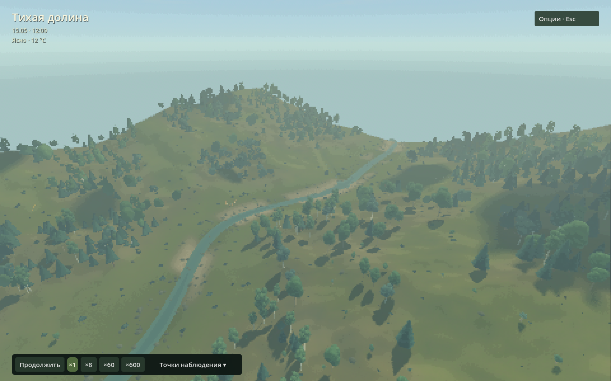

# Тихая долина · Forest Observatory

Учебная лесная обсерватория: гуляем по долине, наблюдаем воду, растения, грибы и животных, меняем условия и проверяем, что произошло. Это открытый для изучения **исходный код исследовательского прототипа**, не готовый прогноз реального леса.



## С чего начать

| Хочется… | Куда идти |
|---|---|
| Запустить и разобраться за десять минут | [Первое знакомство](docs/guide.md) |
| Понять расчёты, единицы и ограничения | [Все модели](docs/models.md) |
| Провести небольшой учебный эксперимент | [Практикум](docs/course.md) |
| Изменить код, вид или параметры | [Разработка и проверки](docs/development.md) |
| Добавить растение или животное | [Каталог ресурсов](docs/species.md), [движения животных](docs/animal-motion.md) |
| Разобраться в численной гидрологии | [Native-ядро](native/README.md) |
| Посмотреть историю решений | [Датированные проверки](verification/), [исторический план](DEVELOPMENT_PLAN.md) |

## Запуск из исходников

Проверенная сборка: **Linux x86_64, Redot 26.3, Forward+ / Vulkan, NVIDIA**. Скрипт запуска контролирует температуру через `nvidia-smi`. Это пока не универсальный установщик для Windows/macOS или других видеокарт. Нужны Git, CMake, компилятор C++17 и Python 3 для сборки и служебных скриптов. Модели во время игры работают на C++/GDScript, не в Python.

В каталоге полученного репозитория:

```bash
export REDOT_BIN=/absolute/path/to/redot.linuxbsd.editor.x86_64
./tools/build_hydro.sh
./tools/run.sh --headless --editor --import --quit
./tools/run.sh
```

Первой сборке нужен интернет для закреплённого `redot-cpp`. Сам редактор Redot устанавливается отдельно; Godot автоматически вместо него не подставляется. Подробности и отдельная сборка без графики — в [руководстве разработчика](docs/development.md).

## В долине

Пробел — пауза; ПКМ + WASD — свободная камера; ЛКМ — карточка объекта. Внизу — скорость и точки наблюдения, включая **«Тихий ключ»** в боковом овраге. **Esc** открывает опции, **V** — общую карту воды и почвы, **G** — локальный грибной участок. Остальное можно освоить по ходу [короткой прогулки](docs/guide.md#первая-прогулка).

В сценарии 512 × 512 м связаны поверхностная и грунтовая вода, конечные запасы C/N/P, 29 растительных ресурсов, три грибных участка и пять видов животных. Для наглядности вода, сутки и биология имеют разные, явно заданные масштабы времени. Сохранение массы проверяется численно; это **не** доказательство экологической или гидрологической достоверности. Параметры сценарные, не подогнаны к полевым данным.

## Статус учебной версии

Один основной пиксельный вид; старые контрольные стили доступны только разработчику. Диагностика воды собрана в V, отдельной карты на M больше нет. Ключ — реальный внешний приток 0,04 м³/с в реальном рельефе, не бесконечная декоративная текстура. Новая геометрия требует нового мира: старые несовместимые сохранения не переписываются и не импортируются молча.

Скриншоты в документации сняты из приложения, не сгенерированы. Зимний кадр явно обозначает просмотр сезона, а не результат многолетнего расчёта. [Воспроизведение кадров и условия](docs/development.md#скриншоты).

**Перед публичным распространением:** лицензия собственного кода ещё не выбрана. Наличие исходников не заменяет разрешения на переиспользование. Лицензии включённых зависимостей и научные источники перечислены в [атрибуции](docs/development.md#лицензии-и-атрибуция).
