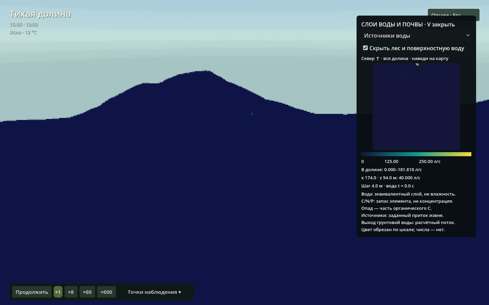

# Небольшой практикум для курса

[Главная](../README.md) · [Управление](guide.md) · [Модели и ограничения](models.md)

Цель — научиться отличать красивую картинку, работу алгоритма и проверенную гипотезу. Для первых опытов достаточно интерфейса; для численных сравнений есть скрипты. У каждого опыта сначала формулируем ожидаемый эффект и условие, при котором откажемся от объяснения.

## До начала

Запиши ревизию (`git rev-parse HEAD`), seed, конфигурацию, состояние паузы, скорость и начальное сохранение. Сравнивай **одинаковое завершённое модельное время**, не одинаковые секунды видеозаписи. Не используй T для «промотки»: это просмотр без расчёта. Меняй один фактор; при независимых повторах используй несколько seed и не выбирай только удачные кадры.

Величины и единицы: водные объёмы м³, расходы м³/с, глубины м/мм; C/N/P — кг элемента или г/м². Числа в карточках принадлежат сценарию, не полевой выборке. Для каждой таблицы подпиши, что является входом, состоянием, потоком или накопленным выходом.

## 1. Где вода появляется, а где просто перемещается?

**Гипотеза:** ключ создаёт боковой поток за счёт заданного внешнего притока, а не благодаря декорации воды.

Посети «Тихий ключ», затем открой V → «Источники воды». Найди 40 л/с около (174, 92) м. Сопоставь с поверхностной глубиной. Не путай этот слой с «Выходом грунтовой воды».

Для строгого опыта запусти:

```bash
./tools/run.sh --headless --script res://tools/check_spring.gd
```

Скрипт использует настоящий рельеф, но **искусственно осушает** воду, отключает дождь, грунтовый обмен, испарение и инфильтрацию. Это изолированный тест, не обычная сцена. За 300 водных секунд ожидаемый приход `0,04 × 300 = 12 м³`. Метрики: вход, водный остаток баланса, объём ниже истока. Отрицательный контроль проходит тем же путём с Q=0 и должен остаться сухим. Фальсификаторы: вода без источника, несовпадающий приход или отсутствие переноса вниз.



## 2. Почему преграда не означает «вода исчезла»?

**Гипотеза:** при одинаковом времени преграда перераспределяет воду, увеличивая запас выше себя и задерживая выход; сама по себе не уничтожает её.

Сохрани исходное состояние на паузе. В первом запуске оставь B выключенной, во втором загрузи исходное состояние и включи B. Используй точку «У преграды», один слой глубины и одинаковую шкалу. Фиксируй запас выше/ниже и накопленный сток в отчётах, а не только цвет одного пикселя.

Строгие изолированные численные случаи — `native/build/hydro_checks`. Реальная сцена дополнительно содержит осадки, испарение и транспирацию: их выходы нельзя выбросить из баланса. Отрицательный контроль — неподвижное озеро без напора; преграда не должна создавать поток из ничего. Отказ от объяснения: «потерянная» вода, которую нельзя найти ни в запасах, ни в выходах.

## 3. Меньше воды — меньше роста?

**Гипотеза:** ограничение корневого снабжения повышает стресс и уменьшает накопление биомассы при остальных равных условиях.

Выбери растения одной группы, запиши исходный возраст, C и стресс. Для формального сравнения настрой два одинаковых сценария в отдельных копиях конфигурации, меняя только водное снабжение. Одного случайного дерева на сухом склоне и другого в тени недостаточно: вместе с водой изменились свет, вид и местообитание.

Измеряй фактическую транспирацию, изменение C и стресс за одинаковое биологическое время. Контроль — тот же pipeline без водного ограничения; дополнительный тест конечности — запрос больше доступного корневого запаса. Фальсификатор: рост/выдача воды сверх доступного ресурса. Программы: [check_ecology.gd](../tools/check_ecology.gd), [check_understory.gd](../tools/check_understory.gd).

## 4. Откуда берётся грибное кольцо?

**Гипотеза:** фронт колонии возникает из взаимодействия биомассы, конечного ресурса и пространственного распространения, а не из шейдера кругов.

G показывает мицелий и ресурс первого участка. Это локальные 32 м, не вся карта. Фиксируй профиль B/R, радиус/ширину фронта и интеграл C, а не количество нарисованных шляпок. Начальный рисунок уже имеет модельную предысторию.

Сначала изучи бумажный референс и его отличие от лесной связанной версии в [описании модели](models.md#8-грибы-и-реакционно-диффузионные-участки). Для самостоятельного опыта сравни одинаковую исходную колонию с нормальной диффузией и D=0. Контроли без инокулюма и без ресурса обязаны подавить соответствующий рост; выполнены в `native/build/fungi_checks`. Не переноси доказательства из чистой двухполевой системы автоматически на микоризную экосистему.

## 5. Животные — агенты или частицы декорации?

**Гипотеза:** кормление уменьшает конечный донорский запас и увеличивает/поддерживает запас потребителя с учётом потерь, а не создаёт корм при каждом укусе.

Перейди к зайцам или кабанам, включи слежение и запиши последовательность действий. Затем проверь модельные изменения резервов, память мест и состояние кормового участка. Наблюдение «заяц дошёл до куста» само по себе не доказывает, что питание рассчитано.

Для численного контроля: [check_animals.gd](../tools/check_animals.gd), [check_population.gd](../tools/check_population.gd), [check_food_web.gd](../tools/check_food_web.gd). Нулевой контроль — недоступный/пустой донор: он не может выдавать корм. Конечность резервов не доказывает, что рацион, темп размножения или плотность популяции реалистичны.

## 6. Графика меняет физику?

**Гипотеза:** переключение качества теней/объёмного света и просмотр сезонов на паузе меняют кадр, но не запасы моделей.

Сохрани паузу и ракурс, сравни скриншоты. Для проверки состояния сравни сериализованные снимки всех моделей до и после; корректное изменение картинки недостаточно. [capture_course_docs.gd](../tools/capture_course_docs.gd) делает именно такой контроль для документирующих кадров. Наблюдатель и камера могут измениться; авторитетные модельные запасы — нет.

## Короткая форма отчёта

1. Вопрос, гипотеза, заранее выбранный фальсификатор.
2. Ревизия, конфигурация/seed, модельное время и единицы.
3. Изменённый фактор и одинаковые исходные условия.
4. Отрицательный/нулевой контроль через тот же расчётный путь.
5. Таблица измерений, график/кадры с общей шкалой; не только «красиво/некрасиво».
6. Вывод в пределах проверки. Отдельно — численная корректность, чувствительность к шагу/сетке и отсутствующая физическая/экологическая валидация.

Неудачный опыт с обнаруженным нарушением — полезный результат. Смена метрики после просмотра ответа требует нового опыта, а не превращает старый в подтверждение.
