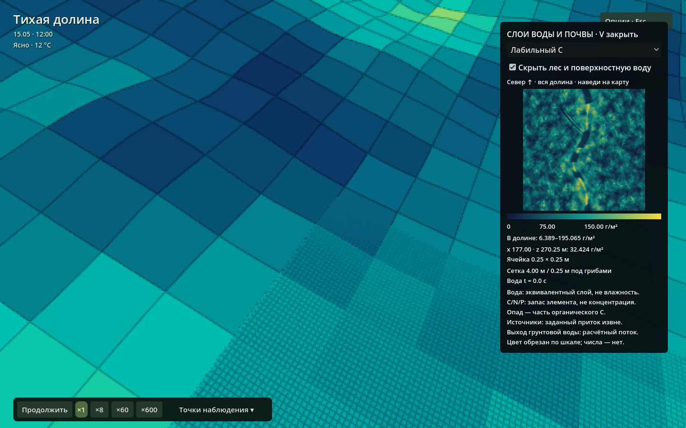

# Первое знакомство с «Тихой долиной»

[Главная](../README.md) · [Как устроены модели](models.md)

В долине можно просто гулять и наблюдать. Если хочется разобраться глубже, останови время, осмотри растение или загляни на карту почвы. Дождь и преграду в ручье можно переключать прямо во время работы.

## Установка

Собери проект по [инструкции в README](../README.md#запуск-из-исходников). Для первой сборки нужны редактор Redot 26.3, Linux x86_64 и инструменты C++17/CMake/Git/Python 3. Включённый Terrain3D и нативное расширение рассчитаны на этот проверенный путь. Ошибки «Redot not found», отсутствие библиотеки или телеметрии разобраны в [разработке](development.md#если-не-запускается).

## Первая прогулка

1. **Поставь паузу пробелом.** Камера и карточки продолжают работать, модели не стареют.
2. Внизу открой **«Камера → У ручья»**. WASD двигает камеру без зажатой мыши, ПКМ поворачивает взгляд. В том же меню выбери «Прогулка», чтобы опуститься на землю; «Полёт» вернёт свободную камеру. Shift ускоряет движение, Q/E меняют высоту только в полёте.
3. Кликни растение, гриб или животное. В карточке видны текущие модельные величины. Для выбранного животного C включает слежение; повторное нажатие выключает его.
4. Перейди к **«Тихому ключу»** через меню точек. Небольшой боковой овраг соединён с основным руслом. Источник находится у его верхнего конца, примерно x=174, z=92 м.
5. Открой **V**, выбери «Поверхностная вода» и затем «Источники воды». Наведи курсор на маленькую карту: появятся координаты и значение ячейки. Север сверху, x направлен вправо, z вниз. Чекбокс скрытия леса помогает читать окраску рельефа.
6. Закрой V, сними паузу и понаблюдай на ×1. Доступны темпы ×1, ×2, ×4 и ×8; при нагрузке фактический темп может быть ниже выбранного.

*Укрытый растительностью верхний конец оврага. Вода движется по тому же рельефу, который виден на экране.*

## Управление без запоминания всего сразу

Основные команды есть в **Меню → Управление**; Esc открывает и закрывает меню. На основном экране нет постоянной памятки клавиш.

| Действие | Клавиша / кнопка |
|---|---|
| Пауза / продолжить | Пробел, кнопка внизу |
| Темп всего мира | ×1, ×2, ×4, ×8 внизу |
| Движение камеры | WASD; Shift быстрее, Q/E вверх/вниз в полёте |
| Повернуть взгляд | Зажать ПКМ; отпускание возвращает курсор |
| Прогулка / полёт | «Камера» / P |
| Перейти к месту / животным | «Камера»; 1–9 для первых девяти точек |
| Карточка объекта | ЛКМ |
| Следовать выбранному животному | C / кнопка карточки |
| Дождь / прекращение осадков до следующего фронта | R / «Опции → Мир» |
| Преграда в главном русле | B / «Опции → Мир» |
| Вода и почва | V / «Опции → Мир» |
| Мицелий и питание ближайшего к камере грибного участка | G / «Опции → Мир» |
| Просмотр зимы, весны, лета, осени и возврат | T / «Опции → Мир» |
| Сохранить / загрузить мир | F5 / F9 |
| Показать / скрыть интерфейс | F |
| Открыть / закрыть опции; освободить камеру | Esc |

В прогулке высота глаз — 1,7 м над рельефом, скорость — 2,2 м/с или 5 м/с с Shift. Камера не шагает по слишком крутым берегам и в воду глубже 45 см. Камера проходит сквозь стволы и животных. Скорость камеры задаётся отдельно от темпа мира; движение работает и на паузе. В меню, при вводе текста и потере фокуса окна перемещение блокируется. Переход к точке наблюдения или слежение за животным возвращает свободную камеру.

Карточка выбранного объекта показывает краткое состояние; сведения раскрываются по желанию и прокручиваются внутри карточки. При выборе другого объекта подробности снова свёрнуты. WASD, ПКМ или выход через меню отменяют слежение.

## Как читать карту V

| Группа | Единицы | Что означает |
|---|---|---|
| Поверхностная вода | мм | Глубина над дном ячейки |
| Верхний, корневой, грунтовый запас | мм | Эквивалентный столб воды на площадь земли |
| Выход грунтовой воды | мм/ч | Расчётный поток из переполненного подземного резервуара на поверхность |
| Источники воды | л/с на ячейку | Заданный внешний приток |
| Органические/лабильные C/N/P, минеральные N/P | г элемента/м² | Запас элемента на площадь земли |
| Свежий опад C | г C/м² | Часть органического C |

Шкалы фиксированы. Для сравнения разных моментов выбирай один слой. Значения выше верхнего предела имеют один максимальный цвет: точное число показывает наведение. 

В почвенных слоях V видна многомасштабная сетка: 4 × 4 м снаружи грибных участков и 25 × 25 см внутри. Отдельной обводки нет; при приближении камеры видна смена размера ячеек. Наведение на миникарту показывает запас и размер ячейки. Вода остаётся на сетке 4 м даже под грибами. Карта G показывает ближайший к камере по горизонтали центр грибного участка: 32 × 32 м с шагом 0,25 м; название вида указано над картой. Выбор меняется и на паузе.

Источник 40 л/с и выход грунтовых вод — разные вещи. Первый задаётся сценарием как приток из невидимой внешней области; второй вычисляется из состояния местного подземного запаса. Модель не рассчитывает весь водосбор, питающий ключ.

## Время, погода и сезоны

При ×1, если компьютер успевает, одна секунда реального времени соответствует одной водной секунде, 360 солнечным и 13 140 биологическим секундам. Поэтому сутки проходят за 4 минуты, год — за 40 минут: 10 световых циклов на биологический год. Масштабы подобраны отдельно для воды, освещения и биологии. Один общий завершённый шаг не даёт моделям разойтись при перегрузке; фактически достигнутый темп может быть меньше выбранного.

**T — только просмотр на паузе.** Меняются сезонная окраска и освещение. Возраст растений, вода и накопленный снег сохраняются. После четырёх сезонов возвращается текущая дата и прежнее состояние паузы.

Погода меняется собственными фронтами. Дождевые пятна переносятся вместе с нижними облаками: под плотным участком идёт дождь, в разрыве остаётся сухо. R меняет интенсивность осадков на 85 водных секунд; местная сила дождя по-прежнему зависит от облачного поля. Снег хранится как водный эквивалент; модели промерзания почвы и речного льда нет.

## Сохранения

F5 сохраняет весь связанный мир, выбор, камеру (включая режим прогулки), скорость и паузу в пользовательский каталог Redot (`user://`); F9 загружает его. Это один слот. Перед перезаписью важного опыта сохрани отдельную копию файла средствами ОС. Имя файла — `observatory-world-v1.bin` (константа `WORLD_SAVE` в [forest.gd](../scripts/forest.gd)).

При загрузке проверяются рельеф и конфигурация моделей. Если они отличаются от сохранённых, приложение отклонит файл и сохранит текущее состояние. После изменения сценария создай новый мир.

Графические настройки действуют до завершения приложения.

## Вид и нагрузка

«Опции → Вид»: лимит FPS, детализация берега, освещение травы, тени облаков, объёмный свет и качество теней. Качество теней имеет четыре ступени; максимальная выбрана по умолчанию. Эти параметры управляют изображением и стоимостью кадра. Состояние моделей при переключении сохраняется. В полутени облаков может быть заметна дискретность растрового фильтра.

Если сложно увидеть эффект, начни с паузы, одного ракурса и переключения только одного параметра. Не сравнивай разные погоду, время и положения камеры одновременно.
