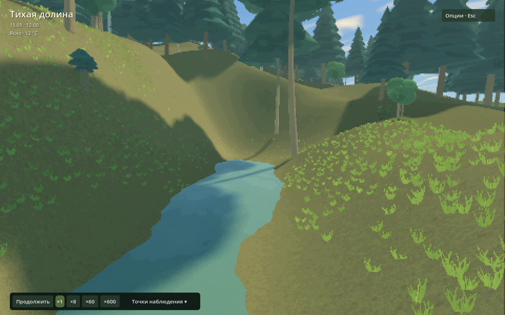
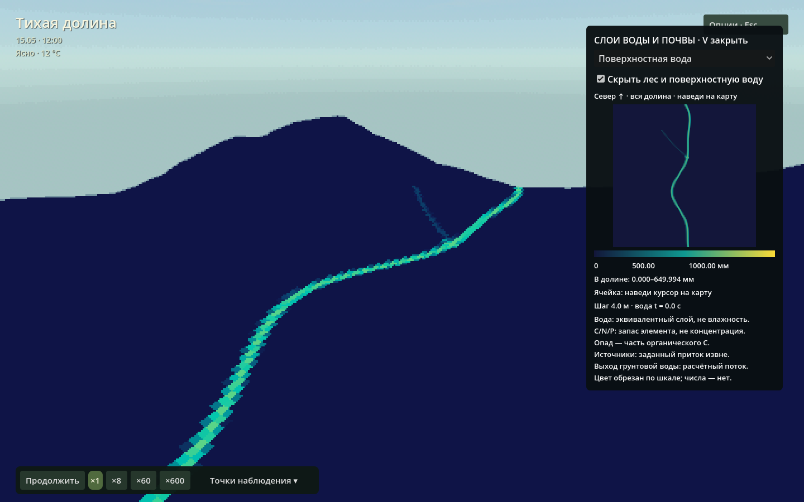
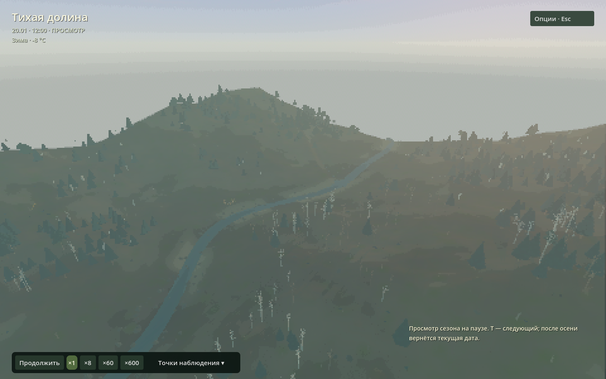
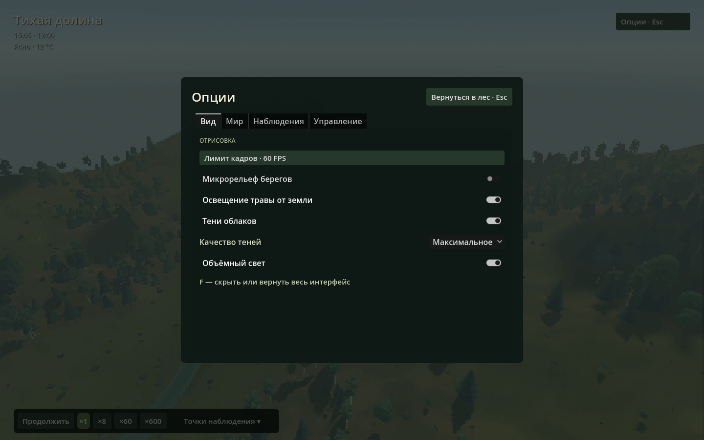

# Первое знакомство с «Тихой долиной»

[Главная](../README.md) · [Как устроены модели](models.md) · [Задания для курса](course.md)

Никаких очков и обязательной цели здесь нет. Это маленький связанный мир: можно остановить время, осмотреть объект, изменить дождь или поставить преграду, затем смотреть не только на картинку, но и на измеряемые запасы.

## Установка

Сейчас распространяются исходники, а не готовый пакет. Выполни [четыре команды из README](../README.md#запуск-из-исходников). Для первой сборки нужны редактор Redot 26.3, Linux x86_64 и инструменты C++17/CMake/Git/Python 3. Включённый Terrain3D и нативное расширение рассчитаны на этот проверенный путь. Ошибки «Redot not found», отсутствие библиотеки или телеметрии разобраны в [разработке](development.md#если-не-запускается).

## Первая прогулка

1. **Поставь паузу пробелом.** Камера и карточки продолжают работать, модели не стареют.
2. Внизу открой **«Точки наблюдения → У ручья»**. Зажми ПКМ и используй WASD; Q/E меняют высоту, Shift ускоряет полёт. Отпусти ПКМ, чтобы вернуть курсор.
3. Кликни растение, гриб или животное. В карточке видны текущие модельные величины. Для выбранного животного C включает слежение; повторное нажатие выключает его. Эти числа не являются реальными измерениями организмов.
4. Перейди к **«Тихому ключу»** через меню точек. Небольшой боковой овраг соединён с основным руслом. Источник находится у его верхнего конца, примерно x=174, z=92 м.
5. Открой **V**, выбери «Поверхностная вода» и затем «Источники воды». Наведи курсор на маленькую карту: появятся координаты и значение ячейки. Север сверху, x направлен вправо, z вниз. Чекбокс скрытия леса помогает читать окраску рельефа.
6. Закрой V, сними паузу и понаблюдай на ×1. Скорость ×8 удобна для первых опытов; ×600 — требование к симуляции, а не обещание такой скорости на любом компьютере.

*Укрытый растительностью верхний конец оврага. Вода движется по тому же рельефу, который виден на экране; декоративное смещение грунта не создаёт русло.*

## Управление без запоминания всего сразу

Основные команды есть в **Esc → Управление**.

| Действие | Клавиша / кнопка |
|---|---|
| Пауза / продолжить | Пробел, кнопка внизу |
| Темп всего мира | ×1, ×8, ×60, ×600 внизу |
| Полёт и взгляд | ПКМ + WASD, Q/E, Shift |
| Перейти к месту / животным | Меню точек; 1–9 для первых девяти |
| Карточка объекта | ЛКМ |
| Следовать выбранному животному | C / кнопка карточки |
| Дождь / прекращение осадков до следующего фронта | R / «Опции → Мир» |
| Преграда в главном русле | B / «Опции → Мир» |
| Вода и почва | V / «Опции → Мир» |
| Мицелий и питание первого грибного участка | G / «Опции → Мир» |
| Просмотр зимы, весны, лета, осени и возврат | T / «Опции → Мир» |
| Сохранить / загрузить мир | F5 / F9 |
| Показать / скрыть интерфейс | F |
| Открыть / закрыть опции; освободить камеру | Esc |

M больше не открывает вторую карту воды. Основной вид один; старые «Исходный» и «Живописный» сохранены лишь как разработческие контроли.

## Как читать карту V

| Группа | Единицы | Что означает |
|---|---|---|
| Поверхностная вода | мм | Глубина над дном ячейки |
| Верхний, корневой, грунтовый запас | мм | Эквивалентный столб воды на площадь земли, **не** глубина до зеркала |
| Выход грунтовой воды | мм/ч | Расчётный поток из переполненного подземного резервуара на поверхность |
| Источники воды | л/с на ячейку | Заданный внешний приток, не текущая скорость воды в русле |
| Органические/лабильные C/N/P, минеральные N/P | г элемента/м² | Запас элемента на площадь земли, **не** концентрация раствора |
| Свежий опад C | г C/м² | Часть органического C, а не дополнительный запас |

Шкалы фиксированы. Один и тот же цвет можно сравнивать между моментами **в одном слое**, но не между разными слоями. Значения выше верхнего предела имеют один максимальный цвет: точное число показывает наведение. Карта всей долины имеет шаг 4 м; грибная карта G — другой масштаб, только участок 32 × 32 м с шагом 0,25 м.

Источник 40 л/с и выход грунтовых вод — разные вещи. Первый задаётся сценарием как приток из невидимой внешней области; второй вычисляется из состояния местного подземного запаса. Модель не рассчитывает весь водосбор, питающий ключ.

## Время, погода и сезоны

При ×1, если компьютер успевает, одна секунда реального времени соответствует одной водной секунде, 360 солнечным и 13 140 биологическим секундам. Поэтому сутки проходят за 4 минуты, год — за 40 минут: 10 световых циклов на биологический год. Это намеренная учебная разномасштабность, не физически подобное ускорение целого водосбора. Один общий завершённый шаг не даёт моделям разойтись при перегрузке; фактически достигнутый темп может быть меньше выбранного.

**T — только просмотр на паузе.** Меняются сезонная окраска и освещение, но не возраст растений, вода или накопленный снег. После четырёх сезонов возвращается текущая дата и прежнее состояние паузы. Это не способ промотать год.

Погода меняется собственными фронтами. R временно меняет осадки; следующий фронт может их снова изменить. Снег хранится как водный эквивалент; модели промерзания почвы и речного льда нет.

## Сохранения и новая версия рельефа

F5 сохраняет весь связанный мир, выбор, камеру, скорость и паузу в пользовательский каталог Redot (`user://`); F9 загружает его. Это один слот. Перед перезаписью важного опыта сохрани отдельную копию файла средствами ОС. Имя файла — `observatory-world-v1.bin` (константа `WORLD_SAVE` в [forest.gd](../scripts/forest.gd)).

Новый овраг меняет расчётное дно. Сохранение от прежнего рельефа будет **отклонено без изменения текущего мира**, а не «подстроено» с потерей водного баланса. Для ключа нужен свежий запуск текущего сценария. Само обновление исходников не закрывает открытое окно и не удаляет старый файл.

Графические переключатели действуют в рамках запуска, это пока не отдельный файл пользовательских предпочтений.

## Вид и нагрузка

«Опции → Вид»: лимит FPS, детализация берега, освещение травы, тени облаков, объёмный свет и качество теней. Качество теней имеет четыре ступени; максимальная выбрана по умолчанию. Эти параметры меняют изображение и стоимость кадра, **не** физический сток, запасы C/N/P или решения животных. Полутень облаков может сохранять небольшую дискретность: это ограничение растрового фильтра, не пятнистая влажность почвы.

Если сложно увидеть эффект, начни с паузы, одного ракурса и переключения только одного параметра. Не сравнивай разные погоду, время и положения камеры одновременно.
