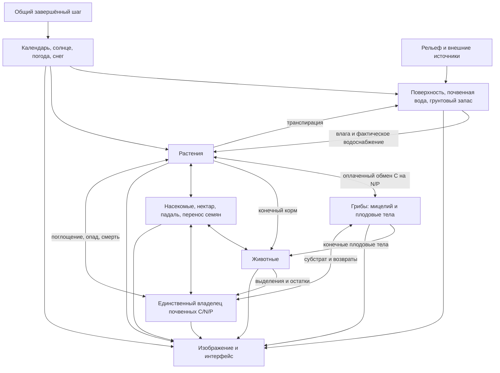

# Модели: что именно рассчитывается

[Главная](../README.md) · [Управление](guide.md) · [Учебные опыты](course.md) · [Код и проверки](development.md)

Это описание **текущего сценария**, а не перечень обещаний из плана. Все числа ниже — значения по умолчанию из [ForestSettings](../scripts/settings.gd) и [forest.tres](../data/forest.tres), если не оговорено другое. Параметры учебные, без полевой калибровки. Модель может правильно сохранять массу и при этом неверно описывать реальную экосистему.

## Навигация

| Основа мира | Живые системы | Наблюдение |
|---|---|---|
| [Рельеф и ключ](#1-пространство-рельеф-и-начальные-условия) | [C/N/P-почва](#6-почвенные-cnp-и-владение-веществом) | [Сохранения и выбор](#11-наблюдение-и-сохранения) |
| [Три масштаба времени](#2-время-и-порядок-расчёта) | [Растения и свет](#7-растения-подлесок-свет-и-возобновление) | [Только изображение](#12-что-является-только-изображением) |
| [Погода и снег](#3-климат-солнце-погода-и-снег) | [Грибы](#8-грибы-и-реакционно-диффузионные-участки) | [Научные источники](#источники-и-уровень-доказательности) |
| [Поверхностная вода](#4-поверхностная-вода) | [Животные](#9-животные-память-и-популяции) | |
| [Почвенная и грунтовая вода](#5-почвенная-и-грунтовая-вода) | [Насекомые, семена и следы](#10-среда-обитания-насекомые-и-следы) | |

## Карта связей



Стрелка означает конкретный обмен/воздействие, не полное решение всех природных процессов. Основные владельцы состояния зарегистрированы в `_world_models()` в [forest.gd](../scripts/forest.gd). Представление читает завершённые состояния, но не добавляет воду или пищу.

## 1. Пространство, рельеф и начальные условия

| Величина | Значение |
|---|---|
| Область | 512 × 512 м, север сверху карты |
| Визуальный рельеф | Terrain3D, базовый шаг около 1 м |
| Гидрология и основная почва | 128 × 128 ячеек, шаг 4 м |
| Грибные участки | Три неперекрывающихся квадрата 32 × 32 м, шаг 0,25 м |
| Агрегированная среда животных | 16 × 16 ячеек, шаг 32 м |
| Воспроизводимость | Локальные генераторы, seed 29017; конфигурация тоже часть опыта |

[landscape.gd](../scripts/landscape.gd) задаёт склон, извилистое русло, шум рельефа и мозаику местообитаний. Размещение растений использует пригодность местообитания и лесные массивы с локально преобладающими породами. Камни и геометрия растительности процедурные. Это синтетическая долина, не цифровая модель измеренного участка.


**Тихий ключ.** Устье бокового оврага выходит к основному руслу около z=189 м; верхний конец расположен около (174, 92) м. Глубина вреза у истока — около 8 м, ширина изменяется плавным профилем. Одна аналитическая поверхность используется и Terrain3D, и расчётным дном. Эрозия, перенос наносов и развитие оврага во времени **не** моделируются.

В основном верховье задано 2 м³/с. Ключ добавляет **0,04 м³/с = 40 л/с** из внешнего, не разрешённого в области водосбора. Это граничное условие, не самостоятельное рождение воды и не вычисленный дебит артезианской скважины. Начальная вода ручья, включая тонкий слой в овраге, входит в начальный баланс. Деревья, почва и популяции тоже имеют явно заданные начальные запасы; грибные колонии проходят отдельную предысторию перед началом общего наблюдения.

## 2. Время и порядок расчёта

[ecology_clock.gd](../scripts/ecology_clock.gd), [forest.gd](../scripts/forest.gd).

| Время | Для чего | Прибавка на одну водную секунду |
|---|---|---|
| Гидрологическое | Потоки, дождь, испарение, транспирация | 1 с |
| Солнечное | Час суток, положение солнца, суточная активность | 360 с |
| Биологическое | Дата, рост, стресс, старение, грибы, метаболизм | 13 140 с |

Общий фиксированный шаг — 0,5 водной секунды. Следовательно, один биологический шаг — 6570 с; сутки света при ×1 занимают 240 водных секунд, год биологии — 2400. Один биологический год содержит 10 видимых световых циклов, а не 365. Это **разделение временных масштабов**, не физически подобное увеличение скорости всех процессов в 13 140 раз. Годовой водный баланс реальной территории по нему предсказывать нельзя.

Кнопки ×1/2/4/8 умножают запрос общего времени. При перегрузке растёт очередь запроса, а модели завершают согласованные шаги; нельзя отдельно промотать биологию, оставив воду позади. В рабочем режиме связанный шаг исполняет один worker; перед чтением/изменением моделей выполняется join. Картинка интерполирует уже завершённый интервал, не предсказывает будущий мир.

Внутри шага используются последовательные обмены: это операторное расщепление, а не одновременное неявное решение всей экосистемы. Чувствительность к шагу и порядку обменов проверяется, но полностью не исчезает.

## 3. Климат, солнце, погода и снег

[climate.gd](../scripts/climate.gd), [weather.gd](../scripts/weather.gd).

Календарь имеет 365 суток без високосных лет. Сезонная температура:

`T(d) = 5,5 + 14 cos(2π(d − 200)/365) °C`.

Широта 60° и аналитическая геометрия наклонения Земли задают высоту/азимут солнца и длину дня. Фенология имеет видовые даты распускания/опадения и плавные переходы. Это сценарная сезонность, не расчёт фотосинтеза по метеостанции.

Детерминированные фронты с переходами примерно через 85 водных секунд меняют облачность, осадки, ветер и температурное отклонение. Дождь пространственно однороден; верхний сценарный ориентир — 30 мм/ч. R переопределяет осадки только до следующего фронта. Облака на небе — визуальное представление погоды, не гидродинамическая атмосфера.

При T≤0 осадки пополняют единый снежный водный эквивалент, при положительной температуре действует ограниченное запасом градусо-дневное таяние (3 мм/(°C·сут)). Жидкая вода передаётся гидрологии. Снежные частицы не являются вторым запасом. Нет пространственного переноса снега, энергетического баланса, промерзания, речного льда и метеопрогноза.


*Это явно подписанный сезонный просмотр T на паузе. Он не доказывает накопление снегозапаса и не изменяет состояние моделей.*

## 4. Поверхностная вода

[native/hydro.hpp](../native/hydro.hpp), [hydro.cpp](../native/hydro.cpp), [watershed.gd](../scripts/watershed.gd). Подробный [численный контракт](../native/README.md).

Храним дно `z` и глубину `h` в метрах по центрам ячеек, удельные расходы `qx/qz` на гранях в м²/с. Объём между соседями — `q · dt · ширина грани`. Общая грань снимает ровно тот же объём у донора, который добавляет получателю.

Используется **локально-инерциальное приближение** с полунеявным трением Маннинга и смешиванием истории соседних расходов по идее de Almeida. Учтены градиент свободной поверхности, инерция и трение; адвективного ускорения полного уравнения мелкой воды нет. `n=0,055 с/м^(1/3)`, CFL=0,35, максимальный внутренний шаг 1 с (при необходимости уменьшается). Ограничитель числа Фруда 1 удерживает приближение в заявленном режиме; удары, разрушение плотин и бурное сверхкритическое течение не обещаются.

Суммарный расход из донора ограничен его водой. Нет искусственной водяной плёнки и «исправления» отрицательной глубины после расчёта. Север/восток/запад закрыты; юг — односторонний выход по нормальной глубине. Дождь задан в м/с, внешние источники — в м³/с. Источники имеют отдельные веса: малая боковая подача не делит основной расход поровну с верховьем.

B включает участок преграды поперёк русла с превышением гребня 2,7 м. Численное ядро знает произвольные отрезки/гребни, а не специальное правило «если плотина». Отдельной трёхмерной турбулентности вокруг брёвен нет.


**Контроли:** неподвижное озеро, сухая область, аналитический объём дождя, фронт смачивания, стационарный поток Маннинга, преграда/перелив/открытие, ограничения режима, сеточная/временная чувствительность и намеренное добавление неучтённой воды. Для ключа есть отдельный контроль без источника: сухое русло остаётся сухим; с подачей вода действительно уходит ниже истока.

## 5. Почвенная и грунтовая вода

[native/hydro.cpp](../native/hydro.cpp), [soil_profile.gd](../scripts/soil_profile.gd).

Два вертикальных ведра: верхний слой 0,15 м и корневой 0,60 м. Пористость 0,45, полевая влагоёмкость θ=0,28, остаточная влажность θ=0,06. Здесь θ — объём воды / объём почвы. Начальная насыщенность, ёмкость и фактический запас — разные величины.

Инфильтрация ограничена доступной водой, свободной ёмкостью и Ksat=8 мм/ч. Вода сначала резервируется в `pending`, который **входит в баланс**. Раз в 30 водных секунд выполняется перенос в верхний слой, просачивание в корневой, дренаж избытка (2 мм/ч) и испарение выше остатка. Базовое испарение 0,12 мм/ч корректируется климатом. Растения запрашивают транспирацию общим массивом; получают фактическое доступное количество, соседи в ячейке делят долю удовлетворения.

Ниже — **дополнительный концептуальный мобильный резервуар**, не разрешённая насыщенная часть тех же ведёр: мощность 1,5 м, водоотдача 0,18, боковая проводимость 10⁻⁴ м/с. Начальный запас — 60% ёмкости, под исходным руслом насыщение. Напор `H = z − 1,5 + groundwater / 0,18` задаёт ограниченные потоки Дарси между ячейками; избыток насыщения возвращается на поверхность. Это внутренний обмен, не новый внешний источник. Подземные границы закрыты.


Это не Richards, не Green–Ampt и не точный порт Landlab GroundwaterDupuitPercolator. Нет капиллярного подъёма, обратного банкового накопления, напора поверхностного водоёма на грунтовый резервуар и замерзания. «Выход грунтовой воды» в V — последний расчётный поток; неподвижная начальная карта может показывать ноль, не отсутствие грунтовой модели.


*Нулевой поток в этом начальном кадре — не нулевой подземный запас. Слой показывает другую величину, чем предыдущая карта.*

### Общий водный баланс

```text
поверхность + верхний слой + корневой + pending + грунтовый запас
+ накопленный сток + испарение + внешнее глубокое дренирование + транспирация
− начальная вода − накопленные жидкие осадки и внешние источники = остаток
```

Инфильтрация и внутренний дренаж не считаются внешними потерями. Снег имеет отдельный запас в модели погоды: водный баланс ядра начинается с **переданной жидкой** воды, не со всей атмосферной суммы.


## 6. Почвенные C/N/P и владение веществом

[native/soil.hpp](../native/soil.hpp), [soil.cpp](../native/soil.cpp), [soil.gd](../scripts/soil.gd).

Один `ForestSoil` владеет запасами углерода, азота и фосфора: органический и лабильный пулы C/N/P и минеральные N/P. Нативные массивы хранят **кг элемента на ячейку/контрольную область**, карта показывает г/м². Это не концентрации раствора, pH или химические формы N/P.

Мелкие грибные участки получают покрытую ими часть запасов из грубой сетки, а не копию. Основная ячейка сохраняет только непокрытую площадь. При интегрировании карты два разрешения учитываются по площади без двойного счёта. Распад и минерализация зависят от температуры/влажности по качественным сценарным правилам; это не валидированная биогеохимическая кинетика.


Свежий поверхностный C — **подмножество органического C**. Листовой C — подмножество живого C растения; плодовый C растения — подмножество семенного C. Они помогают описать процессы и внешний вид, но не суммируются вторично в общей массе. Падение листьев и гибель переносят уже существующие элементы в почву. Запросы растений на N/P обрабатываются пропорциональным пакетом; последовательность растительных и грибных обменов остаётся частью численного метода.


**Контроли:** консервативное уточнение сетки, запрет перекрытия участков, конечность доноров, массовые возвраты и баланс всего связанного мира. Намеренно добавленный азот обязан нарушить общий бюджет: просто получить маленькое число ошибки недостаточно.

## 7. Растения, подлесок, свет и возобновление

[trees.gd](../scripts/trees.gd), [plant_definition.gd](../scripts/plant_definition.gd), [data/plants](../data/plants), [каталог видов](species.md).

29 ресурсов задают деревья, кустарники, кустарнички, травы и злаки. Одна модель хранит стабильные ID, положение, размер/возраст, живые и мёртвые C/N/P, семена, листовой запас, водный стресс. Гербовый объект может представлять **куртину**, а не отдельный стебель. Визуальная травяная подстилка выводится из занятости растениями и не является дополнительным кормовым резервом.

Размер связан с углеродом сценарной аллометрией `size = (C / C_reference)^(1/3)`. Рост ограничивают сезон, листовая поверхность, пригодность влаги, фактическое водоснабжение, свет и доступные N/P. Свет для растений оценивается отдельным общим полем затенения, а не считывается из декоративной карты GPU-теней. Стресс накапливается во времени; затопление, старение, ветер и дефициты могут приводить к гибели. Начальные 2% поваленных деревьев входят в стартовые запасы мёртвой древесины.

Семена оплачиваются родительским веществом, прорастание требует наличия семян и пригодного места. Клональные многолетники разделяют возраст куртины и побегов. Листопад, семенной опад, поедание и распад мёртвой древесины — переносы конечных запасов, не бесплатное восстановление картинки. Явных стволовых годичных колец, механики корней, биофизики фотосинтеза и реальной демографической калибровки нет.


Эктомикоризные признаки включают обмен: растение платит реальным C за доступные грибные N/P. Наличие в ресурсе иных микоризных признаков не означает реализованный канал: AM/эрикоидный обмен пока не рассчитан.

## 8. Грибы и реакционно-диффузионные участки

[native/fungi.hpp](../native/fungi.hpp), [fungi.cpp](../native/fungi.cpp), [fungi.gd](../scripts/fungi.gd), [data/fungi](../data/fungi).

Три локальных **изолированных** участка: луговой опёнок / ведьмины круги, боровик и лисичка. Это не непрерывное поле грибов на всей долине и не подгрузка вокруг камеры. Колонии проходят начальную модельную предысторию 120 × 30 суток; их рисунок не нарисован вручную. Начальные запасы после этой подготовки — старт общего опыта, не десять лет уже прожитого текущего леса.

В исходной биомасса–ресурсной модели:

```text
∂B/∂t = D_B ∇²B + Y a R B² − mB
∂R/∂t = D_R ∇²R − a R B² + k(Rmax − R)
```

B — мицелий, R — доступный углеродный субстрат, кг C/м²; D — м²/с, m/k — с⁻¹, a — м⁴/(кг²·с). Эта положительная обратная связь с диффузией даёт фронты колонии. Источник идеи и референсных параметров — **Karst, Dralle & Thompson (2016)**, [DOI 10.1371/journal.pone.0149254](https://doi.org/10.1371/journal.pone.0149254). Не следует приписывать статье все наши расширения.

В отдельном бумажном контроле восполнение R внешнее, плодоношение отключено, Y=1. В рабочем лесу доступный ресурс и органика — **зеркала общей почвы**, а не независимые дублирующиеся запасы. Потребление ограничено донором и стехиометрией N/P; собственные грибные запасы — мицелий и плодовые тела. Плодоношение переносит оплаченный C, гибель возвращает вещество в органику. Эктомикоризные виды получают C обменом с хозяином, а не тем же сапротрофным питанием. Влажность влияет на активность, но отдельного грибного водозабора нет.


G показывает **ближайший к камере по горизонтали центр участка**: сверху B, снизу R, 32 м целиком. Название вида указано в подписи; выбор обновляется при движении камеры, в том числе на паузе. В почвенных слоях V те же локальные запасы показаны с шагом 0,25 м поверх основной сетки 4 м, без усреднения внутри участка; водные слои не измельчаются. Шляпки — представители распределённой биомассы; они не владеют дополнительной массой и не должны интерпретироваться как пересчитанные индивидуальные грибы.

В референсе диффундируют B и R; в связанном лесу пространственно распространяется B, а ресурс читается у общей почвы, без независимой диффузии зеркала R. Пятиточечная диффузия имеет отражающие границы, шаг ограничен `dt ≤ 0,225 dx² / max(D)` и скоростью реакции. Все переносы ограничены запасом. **Нет** разрешённых гиф, корневой сети, спор, трёхмерной почвы или доказанной количественной динамики конкретного вида. Контроли сравнивают однородную правую часть с независимым расчётом, случаи без инокулюма/ресурса/диффузии, углеродный баланс, плодовые переносы, чувствительность к сетке/шагу и точное продолжение снимка.

## 9. Животные, память и популяции

[animals.gd](../scripts/animals.gd), [animal_definition.gd](../scripts/animal_definition.gd), [data/animals](../data/animals), [геометрия и движение](animal-motion.md).

| Вид | Начальная численность | Основные роли сценария |
|---|---:|---|
| Заяц | 24 | Растительный корм, добыча хищника |
| Лиса | 2 | Поиск добычи, охота, падаль |
| Рыжая полёвка | 48 | Мелкий растительный корм/семена, добыча |
| Дрозд | 12 | Полёт, растительный корм и беспозвоночные, перенос семян |
| Кабан | 4 | Всеядность, рытьё и вытаптывание |

Численности стартовые, не постоянные декорации. Животные имеют конечные C/N/P, возраст, пол, энергообеспечение, состояния поведения и индивидуальные признаки. Поиск локальный, с пространственным индексом; ограниченная память хранит до четырёх кормовых мест. Домашняя область, сон и экскурсии привязаны к состоянию и солнечному времени. Это правила/агентная модель, **не нейросеть** и не готовый этологический прогноз.

Поедание снимает действительные запасы растений, плодовых тел, насекомых или падали. Метаболизм учитывает выходы; смерть переводит тело в конечную падаль. Потомство оплачивается родительским резервом, есть родительские ID и наследование признаков. Нет тайного автоматического восполнения погибших популяций. Проверки малой сцены не гарантируют устойчивость популяций на десятилетиях.


Перемещение подшаговое, учитывает глубину воды, склон и способности ресурса вида; дрозд может летать. Выбранная геометрия, слежение и клики используют **показанную**, а не будущую worker-позицию. Анимация лап/крыльев не оплачивает корм и не двигает модель самостоятельно.


## 10. Среда обитания, насекомые и следы

[habitat.gd](../scripts/habitat.gd), [habitat_view.gd](../scripts/habitat_view.gd).

Грубая сетка содержит конечные C/N/P пулы агрегированных беспозвоночных: опылители, древесные и детритные группы. Отдельный нарисованный жук не является особью модели. Нектар оплачивается растением, доступность опылителей влияет на размножение. Падаль оплачивается погибшим телом. Переносимые семена резервируются из конечного материнского запаса до высадки, не копируются при каждом посещении.

Трафик животных создаёт следы и воздействует на растения (вытаптывание/рытьё); видимые тропинки — представление накопленного трафика. Это не изменение высоты расчётного дна, не эрозия и не механика уплотнения грунта. Модель служит связующим учебным приближением, а не детальной моделью трофической сети насекомых.

## 11. Наблюдение и сохранения

[observation.gd](../scripts/observation.gd), [world_state.gd](../scripts/world_state.gd), композиция [forest.gd](../scripts/forest.gd).

Общий наблюдатель выбирает растения, грибы и животных по показанной геометрии. Карточка — представление настоящего состояния, а не параллельный расчёт. Карта V переводит SI в удобные единицы на копии массива, не меняя владельца данных.

Сохранение содержит модели, накопленные потоки, незавершённый временной остаток, камеру/выбор и параметры сцены. Запись идёт через временный файл и переименование. Загрузка проверяет версии, совместимость конфигурации/рельефа/источников, согласованность часов и межмодельных ссылок; при поздней ошибке восстанавливает прежние состояния. Повреждённое или старое несовместимое сохранение нельзя «принять наполовину». Нативный водный checkpoint v3 поддерживает веса источников; это не то же самое, что целое сохранение мира v1.

Численные запасы нативных ядер — float64; векторы движка и часть визуальных данных — float32. Это не обещание битовой идентичности на всех платформах. Проверяем точное продолжение на текущем проверенном стеке.

## 12. Что является только изображением

[atmosphere.gd](../scripts/atmosphere.gd), [cloud_deck.gd](../scripts/cloud_deck.gd), [water_view.gd](../scripts/water_view.gd), [painterly_style.gd](../scripts/painterly_style.gd), [shaders](../shaders).

Мир рисуется Terrain3D и пакетной геометрией/уровнями детализации. Основной пиксельный viewport при окне 1440×900 имеет 480×300 пикселей; интерфейс остаётся полноразмерным. Формы крон, трава, окраска почвы, шляпки, дождевые частицы и волны показывают состояние, но не являются дополнительными веществом/особями.

Облака — процедурные слои с общим полем для неба и облачной тени. Мягкость даёт конечный солнечный диск и растровая фильтрация. Объёмный свет — грубый эффект Forward+ (размер 64, 32 слоя глубины), по умолчанию включён. Вода показывает глубину, отражение и нерегулярные визуальные волны/дождевые круги: капля шейдера не добавляет воду в solver. Это не спектральная модель волн и не атмосферная радиационная модель.

Графические переключатели и скрытые контрольные стили не меняют общий водный/CNP баланс. На карте V декоративный покров/туман могут отключаться для читаемости с восстановлением пользовательского выбора. Экспериментальный `modules/fluid` не подключён к текущему водному расчёту.

## Источники и уровень доказательности

- Bates et al. (2010), локально-инерциальная формулировка: [10.1016/j.jhydrol.2010.03.027](https://doi.org/10.1016/j.jhydrol.2010.03.027).
- de Almeida et al. (2012), стабилизация расхода: [10.1029/2011WR011570](https://doi.org/10.1029/2011WR011570).
- [Landlab OverlandFlow](https://github.com/landlab/landlab/tree/master/src/landlab/components/overland_flow), [GroundwaterDupuitPercolator](https://github.com/landlab/landlab/tree/master/src/landlab/components/groundwater): изученные открытые референсы, не зависимость игрового процесса и не заявление об эквивалентности результатов.
- Karst, Dralle & Thompson (2016), биомасса–ресурс: [10.1371/journal.pone.0149254](https://doi.org/10.1371/journal.pone.0149254).
- Растительная аллометрия, фенология, почвенный CNP, трофика и поведения животных — собственные сценарные приближения. Изобразительное правдоподобие не даёт им автоматически научной валидации.

Датированные измерения и отрицательные контроли лежат в [verification](../verification/); воспроизводимые программы — в [tools](../tools/) и [native/checks.cpp](../native/checks.cpp). Старые отчёты описывают свою ревизию: ограничения из них не всегда являются текущими. Для нового утверждения нужны его собственные проверка и данные.
