# Модели: что именно рассчитывается

[Главная](../README.md) · [Управление](guide.md) · [Код и проверки](development.md)

Здесь описан текущий сценарий. Все числа ниже — значения по умолчанию из [ForestSettings](../scripts/settings.gd) и [forest.tres](../data/forest.tres), если не оговорено другое. Параметры подобраны для сценария; полевая калибровка ещё предстоит.

## Навигация

| Основа мира | Живые системы | Наблюдение |
|---|---|---|
| [Рельеф и ключ](#1-пространство-рельеф-и-начальные-условия) | [C/N/P-почва](#6-почвенные-cnp-и-владение-веществом) | [Сохранения и выбор](#11-наблюдение-и-сохранения) |
| [Три масштаба времени](#2-время-и-порядок-расчёта) | [Растения и свет](#7-растения-подлесок-свет-и-возобновление) | [Только изображение](#12-что-является-только-изображением) |
| [Погода и снег](#3-климат-солнце-погода-и-снег) | [Грибы](#8-грибы-и-реакционно-диффузионные-участки) | [Научные источники](#источники) |
| [Поверхностная вода](#4-поверхностная-вода) | [Животные](#9-животные-память-и-популяции) | |
| [Почвенная и грунтовая вода](#5-почвенная-и-грунтовая-вода) | [Насекомые, семена и следы](#10-среда-обитания-насекомые-и-следы) | |

## Карта связей

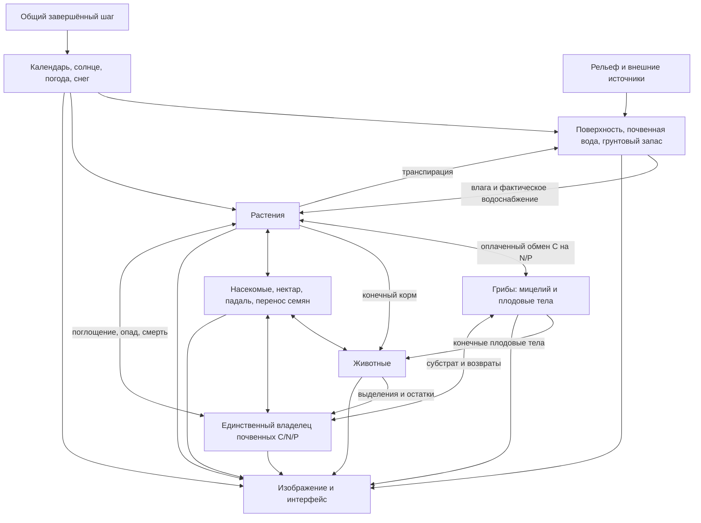

Стрелки показывают обмены и воздействия между моделями. Основные владельцы состояния зарегистрированы в `_world_models()` в [forest.gd](../scripts/forest.gd). Представление читает завершённые состояния.

## 1. Пространство, рельеф и начальные условия

| Величина | Значение |
|---|---|
| Область | 512 × 512 м, север сверху карты |
| Визуальный рельеф | Terrain3D, базовый шаг около 1 м |
| Гидрология и основная почва | 128 × 128 ячеек, шаг 4 м |
| Грибные участки | Три неперекрывающихся квадрата 32 × 32 м, шаг 0,25 м |
| Агрегированная среда животных | 16 × 16 ячеек, шаг 32 м |
| Воспроизводимость | Локальные генераторы, seed 29017; конфигурация тоже часть опыта |

[landscape.gd](../scripts/landscape.gd) задаёт склон, извилистое русло, шум рельефа и мозаику местообитаний. Размещение растений использует пригодность местообитания и лесные массивы с локально преобладающими породами. Камни и геометрия растительности процедурные. Долина генерируется процедурно.

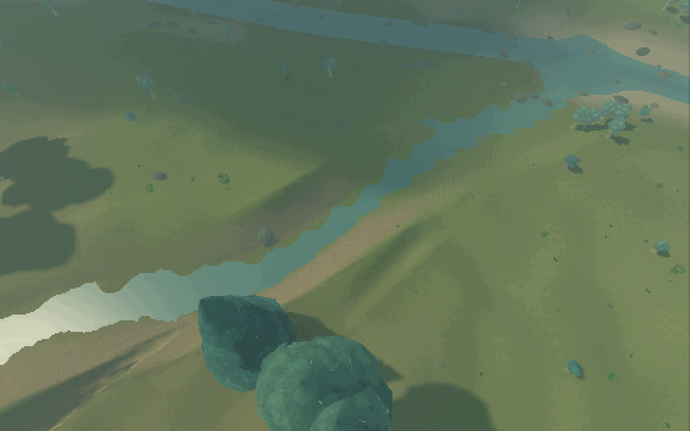

**Тихий ключ.** Устье бокового оврага выходит к основному руслу около z=189 м; верхний конец расположен около (174, 92) м. Дно ключа находится на 26,42 м, устье — на 14,42 м: перепад составляет 12 м. Основной ручей на широте ключа лежит примерно на 9,76 м ниже него. Овраг расширяется вниз по течению, имеет разные поперечные профили берегов и три боковых промоины. Оголённые крутые участки получают минеральную окраску, посадка и возобновление растений учитывают боковое русло. Дно остаётся непрерывно нисходящим и разрешённым гидрологической сеткой 4 м. Одна аналитическая поверхность используется и Terrain3D, и расчётным дном. Эрозия, перенос наносов и развитие оврага во времени **не** моделируются.

В основном верховье задано 2 м³/с. Ключ добавляет **0,04 м³/с = 40 л/с** из внешнего водосбора. Расход задан граничным условием; питающий водосбор находится за пределами расчётной области. Начальная вода ручья, включая тонкий слой в овраге, входит в начальный баланс. Деревья, почва и популяции тоже имеют явно заданные начальные запасы; грибные колонии проходят отдельную предысторию перед началом общего наблюдения.

## 2. Время и порядок расчёта

[ecology_clock.gd](../scripts/ecology_clock.gd), [forest.gd](../scripts/forest.gd).

| Время | Для чего | Прибавка на одну водную секунду |
|---|---|---|
| Гидрологическое | Потоки, дождь, испарение, транспирация | 1 с |
| Солнечное | Час суток, положение солнца, суточная активность | 360 с |
| Биологическое | Дата, рост, стресс, старение, грибы, метаболизм | 13 140 с |

Общий фиксированный шаг — 0,5 водной секунды. Следовательно, один биологический шаг — 6570 с; сутки света при ×1 занимают 240 водных секунд, год биологии — 2400. Один биологический год содержит 10 видимых световых циклов. Масштабы подобраны отдельно для гидрологии, освещения и биологии; их соотношение определяет темп наблюдаемых процессов.

Кнопки ×1/2/4/8 умножают запрос общего времени. При перегрузке растёт очередь запроса, а модели завершают согласованные шаги; нельзя отдельно промотать биологию, оставив воду позади. В рабочем режиме связанный шаг исполняет один worker; перед чтением/изменением моделей выполняется join. Картинка интерполирует уже завершённый интервал.

Внутри шага используется операторное расщепление: модели обмениваются веществом последовательно. Проверки оценивают чувствительность к длительности шага и порядку обменов.

## 3. Климат, солнце, погода и снег

[climate.gd](../scripts/climate.gd), [weather.gd](../scripts/weather.gd).

Календарь имеет 365 суток без високосных лет. Сезонная температура:

`T(d) = 5,5 + 14 cos(2π(d − 200)/365) °C`.

Широта 60° и аналитическая геометрия наклонения Земли задают высоту/азимут солнца и длину дня. Фенология имеет видовые даты распускания/опадения и плавные переходы. Даты и температурная кривая заданы сценарием.

Детерминированные воздушные массы с переходами примерно через 85 водных секунд приходят со стороны ветра следующей массы. Фаза запаздывает на `dot(position − centre, direction) / front_speed`: при скорости фронта 8 м/с переход шириной около 476 м проходит через разные части леса в разное время. На грубой сетке `weather_resolution = 16` заданы облачность, потенциал осадков, температурное отклонение, относительная влажность и вектор ветра. Последовательные направления охватывают весь круг; местный вектор ветра плавно поворачивается при смене массы. Влажность воздуха — сценарное свойство массы; испарение реагирует на неё, запас пара и конденсация пока отсутствуют. Потенциальная интенсивность осадков достигает 30 мм/ч в плотном облачном ядре. R переопределяет потенциал осадков на 85 водных секунд. Фактический дождь распределяется облачным полем.

### Пространственный ветер

[wind_field.gd](../scripts/wind_field.gd) задаёт общее поле для крон, низкой растительности, травяных карточек и [ветрового звука](../scripts/wind_audio.gd). Порывы — детерминированные пространственные пакеты, переносимые накопленным смещением по среднему ветру. Поворот ветра меняет дальнейшее направление переноса плавно. Местный средний вектор берётся из проходящего погодного фронта.

Сетка скорости 32 × 32 обновляется раз в 0,1 отображаемой секунды; между двумя полями действует линейная интерполяция. Отдельная сетка 64 × 64 хранит ослабление у земли и среднюю высоту полога. Вклад крон учитывает размер, листву и показанную позу деревьев/кустарников; поваленные растения исключаются. В плотных насаждениях скорость у земли стремится к 20% открытого ветра и восстанавливается к высоте полога. Сетки и интервал задаются в `ForestSettings`.

Геометрия изгибается по общему полю с видовой гибкостью; корни закреплены, смещение ограничено 0,75 м в мировых координатах. Три стиля и ближний/средний LoD используют один shader include. Дальние атласные силуэты сохраняют неподвижную геометрию. Выделение ближних и средних растений учитывает показанный изгиб. Негромкий зацикленный фильтрованный шум усиливается по той же скорости на высоте наблюдателя; существующие голоса птиц и шорохи животных сохраняются.

Это сценарная модель пространственной связности ветра и укрытия в масштабе насаждений. Ослабление изотропно: направленные следы за отдельными стволами, взаимодействие с рельефом и уравнения атмосферного течения пока отсутствуют. Часы ветра идут в реальном времени при работающей симуляции, останавливаются на паузе и продолжаются при занятом модельном worker. Поле отображения не входит в сохранение. Капли читают эти же две текстуры скорости, полог и высоту над исходным дном гидрологии: горизонтальная скорость плавно приближается к местному ветру, вертикальная скорость падения задана. Кроны, трава, капли и звук используют плавные часы отображения. Облака и риск ветровала используют общий детерминированный профиль порывов на водных часах; при ускорении мира их фаза может расходиться с визуальной раскачкой. Транспирация и рост растений учитывают местные свойства воздушной массы; испарение гидрологии, температурная кинетика почвы и реакции животных пока получают региональный сигнал.

**Проверки:** перенос пакета на заданное расстояние, отвергаемый обратный перенос и однородный контроль, штиль, ослабление/восстановление после удаления крон, CPU/GPU bilinear-сэмплинг, ограничение изгиба, выбор смещённого треугольника, пауза, занятый worker с отключённым доступом view к модели и неизменность авторитетных запасов. [Протокол](../verification/2026-11-05-spatial-wind.md).

### Пространственные осадки и перенос облаков

[cloud_field.gd](../scripts/cloud_field.gd) и [native/weather_field.hpp](../native/weather_field.hpp) задают периодическую двумерную плотность нижнего облачного слоя. Числовой тайл 512×512 с диапазоном 0…1 генерируется [build_cloud_density.gd](../tools/build_cloud_density.gd) и хранится как lossless PNG. Его байты одинаково читают модель и отображение. Размер слоя — `extent × cloud_span_factor` (4096 м по умолчанию). Смещение накапливается по погодному вектору ветра и среднему по девяти точкам открытому порыву. Перенос слоя когерентный: отдельные облачные ячейки сохраняют форму. Тонкий верхний слой использует то же направление накопленного переноса.

Смещение вычисляется по завершённым водным секундам с периодическим оборачиванием. При интерполяции отображения используется та же детерминированная траектория. Кэш на границах погодных интервалов восстанавливается из seed и времени; поворот ветра сохраняет непрерывность положения. Небо, облачная тень и осадки привязаны к одним мировым XZ-координатам. Верхние тонкие облака остаются декоративным слоем. Местная облачность приходит из грубого погодного поля и используется в небе, тенях и осадках. Под прозрачной кромкой нижнего слоя осадков нет: вес дождя плавно растёт от нуля до единицы только в плотных ядрах (`threshold = 0,69 − 0,32 × cover`, диапазон `threshold + 0,10…0,24`).

На середине каждого фиксированного шага модель сэмплирует плотность в центрах водных ячеек и передаёт массив жидких потоков в м/с native-гидрологии. Внешний водный приход равен сумме `rate × dt × cell_area`; CFL учитывает максимальный локальный поток. Нормализации к постоянному среднему нет: при разрывах облаков средний дождь по области уменьшается. Накопленные `precipitation_m` и `liquid_m` — средние по площади водные эквиваленты.

Капли и дождевые круги используют маски местной интенсивности из того же native-сэмплера, включая пространственный потенциал осадков. Частицы снега сохраняют облачную маску; маска кругов включает только жидкие осадки по местной температуре. Отображение берёт её из неизменяемого облачного источника на своих интерполированных часах, без чтения рабочих запасов и GPU-readback в модель. Капли прореживаются устойчивым случайным порогом; их число не участвует в водном балансе. При паузе облачная фаза и модельные поля сохраняются. Погода v1/v2 загружается с сохранением накопленных воды и снега; дальнейшая эволюция следует новому сценарию. Сохранения v3 проверяют хеш облачного источника, размеры, разрешение погоды и скорость фронта.

Влага облаков и конденсация пока не считаются. В расчёт воды осадки поступают вертикально без задержки на падение и ветрового сноса; укрытие осадков кронами отсутствует. Реакции животных и стирание следов всё ещё используют региональный погодный сигнал. [Проверки и границы](../verification/2026-11-05-spatial-rain.md).

### Устойчивость деревьев и ветровал

Ресурс растения задаёт `wind_resistance_m_s`: сценарную устойчивость к порыву для опорного дерева. Порог уменьшается с высотой, размером кроны, стрессом и снеговой нагрузкой; сухостой имеет отдельное понижение прочности, а фоновый распад стоящих мёртвых деревьев сохраняется; потеря листвы уменьшает парусность. Местный погодный ветер умножается на открытый порыв в координатах дерева. Избыток квадратичной ветровой нагрузки задаёт риск отказа за **водные секунды** воздействия. Биологический множитель ускоряет рост и разложение; длительность урагана остаётся на водных часах.

При падении растение погибает, поворачивается по местному ветру и сохраняет C/N/P в существующем пуле мёртвой древесины. Дальше работают обычные световые просветы, укрытия и разложение валежника. Пороги — параметры прототипа; механика корневой плиты, разрушение ствола, столкновения и измеренная видовая калибровка пока отсутствуют. Отдельное отображение падения длится 2,8–4,6 реальных секунд: начальный надлом переходит в ускоряющийся наклон до модельной позы контакта. Пространственный процедурный звук даёт серию тресков и один удар; восемь голосов отдают приоритет ближайшим событиям. Поза выбора и три LoD следуют падению, пауза останавливает движение и звук. Сохранение содержит активные фазы; уже лежащий валежник при загрузке заново не падает. Учёт C/N/P совершается в момент модельного отказа. [Проверки фронтов, капель и ветровала](../verification/2026-11-05-fronts-windthrow.md).

При T≤0 осадки пополняют единый снежный водный эквивалент, при положительной температуре действует ограниченное запасом градусо-дневное таяние (3 мм/(°C·сут)). Жидкая вода передаётся гидрологии. Снежные частицы не являются вторым запасом. Нет пространственного переноса снега, энергетического баланса, промерзания, речного льда и метеопрогноза.

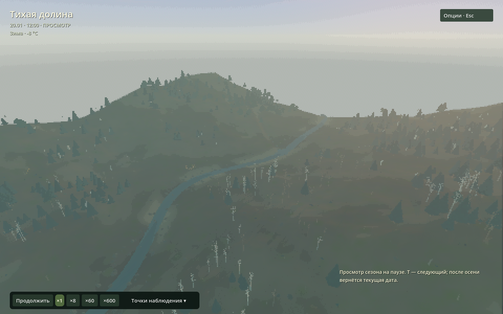

*Зимняя окраска и освещение в режиме сезонного просмотра T. Модели остаются на паузе.*

## 4. Поверхностная вода

[native/hydro.hpp](../native/hydro.hpp), [hydro.cpp](../native/hydro.cpp), [watershed.gd](../scripts/watershed.gd). Подробный [численный контракт](../native/README.md).

Храним дно `z` и глубину `h` в метрах по центрам ячеек, удельные расходы `qx/qz` на гранях в м²/с. Объём между соседями — `q · dt · ширина грани`. Общая грань снимает ровно тот же объём у донора, который добавляет получателю.

Используется **локально-инерциальное приближение** с полунеявным трением Маннинга и смешиванием истории соседних расходов по идее de Almeida. Учтены градиент свободной поверхности, инерция и трение; адвективного ускорения полного уравнения мелкой воды нет. `n=0,055 с/м^(1/3)`, CFL=0,35, максимальный внутренний шаг 1 с (при необходимости уменьшается). Ограничитель числа Фруда 1 удерживает приближение в заявленном режиме; удары, разрушение плотин и сверхкритическое течение находятся за пределами этого приближения.

Суммарный расход из донора ограничен его водой. Нет искусственной водяной плёнки и «исправления» отрицательной глубины после расчёта. Север/восток/запад закрыты; юг — односторонний выход по нормальной глубине. Дождь задан в м/с, внешние источники — в м³/с. Источники имеют отдельные веса: малая боковая подача не делит основной расход поровну с верховьем.

B включает участок преграды поперёк русла с превышением гребня 2,7 м. Численное ядро принимает произвольные отрезки с высотой гребня. Отдельной трёхмерной турбулентности вокруг брёвен нет.

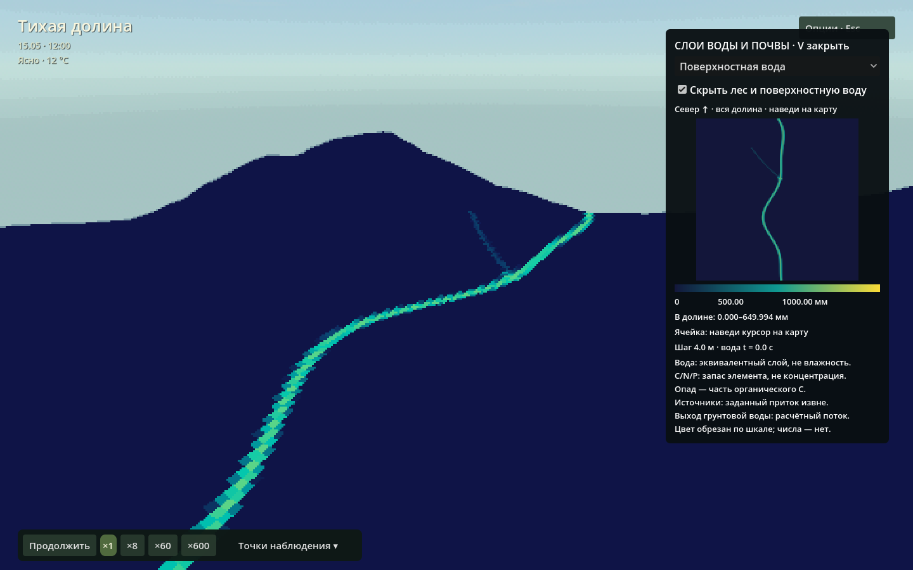

**Контроли:** неподвижное озеро, сухая область, аналитический объём дождя, фронт смачивания, стационарный поток Маннинга, преграда/перелив/открытие, ограничения режима, сеточная/временная чувствительность и намеренное добавление неучтённой воды. Для ключа есть отдельный контроль без источника: сухое русло остаётся сухим; с подачей вода действительно уходит ниже истока.

## 5. Почвенная и грунтовая вода

[native/hydro.cpp](../native/hydro.cpp), [soil_profile.gd](../scripts/soil_profile.gd).

Два вертикальных ведра: верхний слой 0,15 м и корневой 0,60 м. Пористость 0,45, полевая влагоёмкость θ=0,28, остаточная влажность θ=0,06. Здесь θ — объём воды / объём почвы. Начальная насыщенность, ёмкость и фактический запас — разные величины.

Инфильтрация ограничена доступной водой, свободной ёмкостью и Ksat=8 мм/ч. Вода сначала резервируется в `pending`, который **входит в баланс**. Раз в 30 водных секунд выполняется перенос в верхний слой, просачивание в корневой, дренаж избытка (2 мм/ч) и испарение выше остатка. Базовое испарение 0,12 мм/ч корректируется климатом. Растения запрашивают транспирацию общим массивом; получают фактическое доступное количество, соседи в ячейке делят долю удовлетворения.

Ниже расположен **дополнительный концептуальный мобильный резервуар**: мощность 1,5 м, водоотдача 0,18, боковая проводимость 10⁻⁴ м/с. Начальный запас — 60% ёмкости, под исходным руслом насыщение. Напор `H = z − 1,5 + groundwater / 0,18` задаёт ограниченные потоки Дарси между ячейками; избыток насыщения возвращается на поверхность. Обмен учитывается внутри общего водного баланса. Подземные границы закрыты.

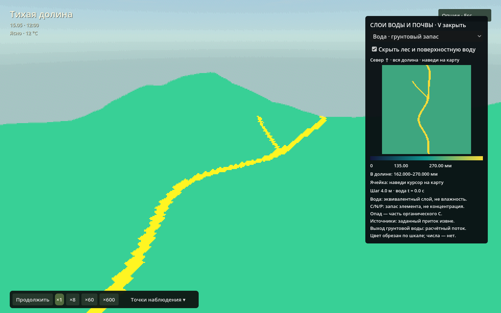

Используется ведёрная схема почвы и концептуальный грунтовый резервуар. Нет капиллярного подъёма, обратного банкового накопления, напора поверхностного водоёма на грунтовый резервуар и замерзания. «Выход грунтовой воды» в V показывает поток за последний расчётный шаг. До первого шага он равен нулю.


*Начальное состояние: грунтовый запас уже задан, выход на поверхность вычисляется с первым шагом.*

### Общий водный баланс

```text
поверхность + верхний слой + корневой + pending + грунтовый запас
+ накопленный сток + испарение + внешнее глубокое дренирование + транспирация
− начальная вода − накопленные жидкие осадки и внешние источники = остаток
```

Инфильтрация и внутренний дренаж не считаются внешними потерями. Снег имеет отдельный запас в модели погоды: водный баланс ядра начинается с **переданной жидкой** воды.

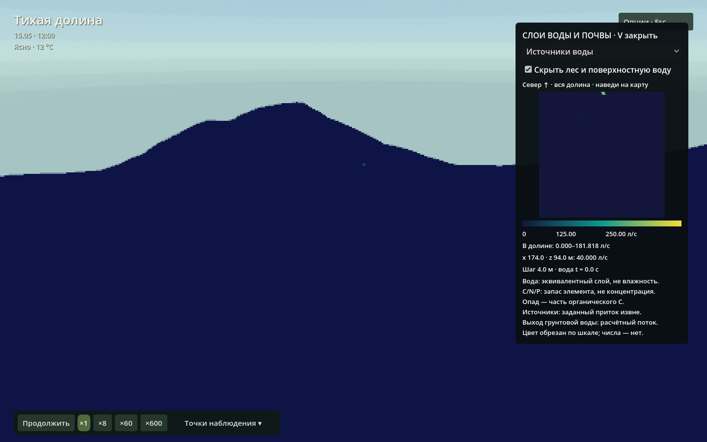

## 6. Почвенные C/N/P и владение веществом

[native/soil.hpp](../native/soil.hpp), [soil.cpp](../native/soil.cpp), [soil.gd](../scripts/soil.gd).

Один `ForestSoil` владеет запасами углерода, азота и фосфора: органический и лабильный пулы C/N/P и минеральные N/P. Нативные массивы хранят **кг элемента на ячейку/контрольную область**, карта показывает г/м². Концентрации раствора, pH и химические формы N/P в модели отсутствуют.

При уточнении сетки покрытая грибными участками часть запасов переносится из основной сетки на мелкую. Основная ячейка сохраняет только непокрытую площадь. При интегрировании карты два разрешения учитываются по площади без двойного счёта. Распад и минерализация зависят от температуры и влажности по сценарным правилам.

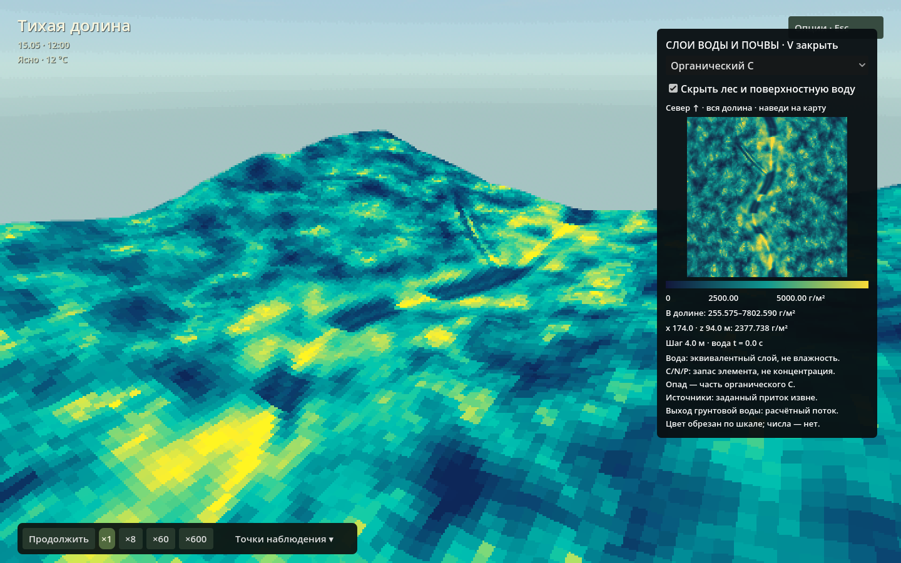

Свежий поверхностный C — **подмножество органического C**. Листовой C — подмножество живого C растения; плодовый C растения — подмножество семенного C. В общей массе каждое вещество учитывается один раз. Падение листьев и гибель переносят уже существующие элементы в почву. Запросы растений на N/P обрабатываются пропорциональным пакетом; последовательность растительных и грибных обменов остаётся частью численного метода.

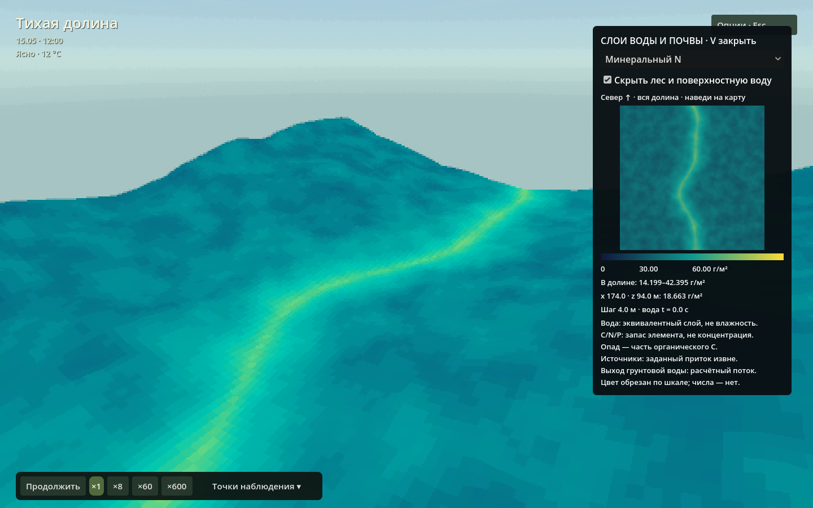

**Контроли:** консервативное уточнение сетки, запрет перекрытия участков, конечность доноров, массовые возвраты и баланс всего связанного мира. Контроль с намеренно добавленным азотом проверяет, обнаруживает ли учёт нарушение бюджета.

## 7. Растения, подлесок, свет и возобновление

[trees.gd](../scripts/trees.gd), [plant_definition.gd](../scripts/plant_definition.gd), [data/plants](../data/plants), [каталог видов](species.md).

29 ресурсов задают деревья, кустарники, кустарнички, травы и злаки. Одна модель хранит стабильные ID, положение, размер/возраст, живые и мёртвые C/N/P, семена, листовой запас, водный стресс. Травянистый объект может представлять **куртину**. Визуальная травяная подстилка выводится из занятости растениями; кормовые запасы принадлежат модели растений.

Размер связан с углеродом сценарной аллометрией `size = (C / C_reference)^(1/3)`. Рост ограничивают сезон, листовая поверхность, пригодность влаги, фактическое водоснабжение, свет и доступные N/P. Свет для растений оценивается отдельным общим полем затенения. Стресс накапливается во времени; затопление, старение, ветер и дефициты могут приводить к гибели. Начальные 2% поваленных деревьев входят в стартовые запасы мёртвой древесины.

Семена оплачиваются родительским веществом, прорастание требует наличия семян и пригодного места. Клональные многолетники разделяют возраст куртины и побегов. Листопад, семенной опад, поедание и распад мёртвой древесины переносят вещество между конечными запасами. Стволовые годичные кольца, механика корней и биофизика фотосинтеза в модели отсутствуют.

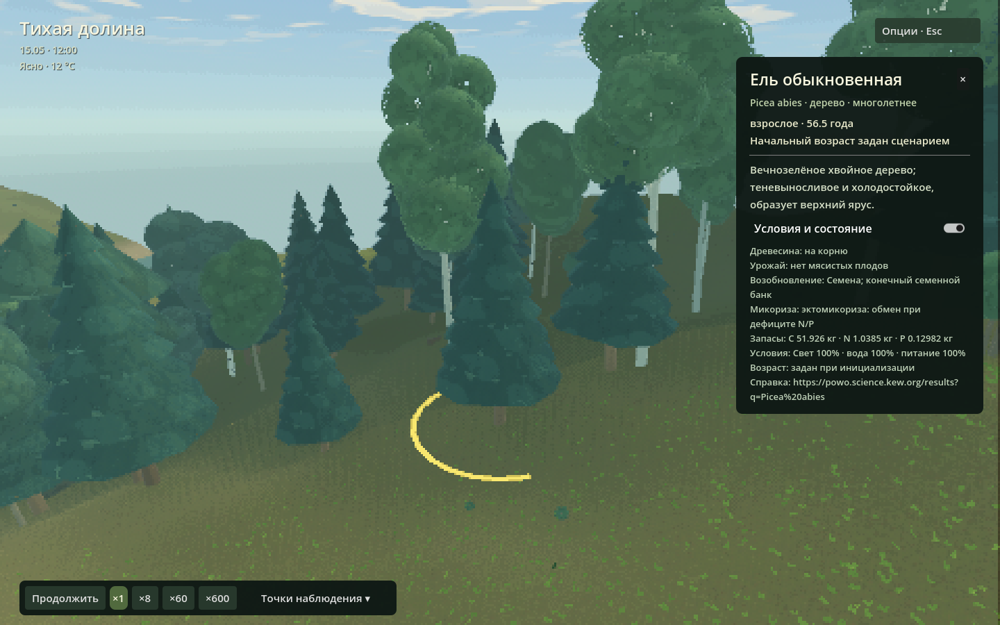

Эктомикоризные признаки включают обмен: растение платит C за доступные грибные N/P. AM/эрикоидные признаки хранятся в ресурсах; соответствующие обмены ещё предстоит реализовать.

## 8. Грибы и реакционно-диффузионные участки

[native/fungi.hpp](../native/fungi.hpp), [fungi.cpp](../native/fungi.cpp), [fungi.gd](../scripts/fungi.gd), [data/fungi](../data/fungi).

Грибы занимают три фиксированных **изолированных** участка: луговой опёнок / ведьмины круги, боровик и лисичка. Перед общим запуском колонии проходят подготовительный расчёт 120 × 30 суток, который формирует их пространственный рисунок и начальные запасы.

В исходной биомасса–ресурсной модели:

```text
∂B/∂t = D_B ∇²B + Y a R B² − mB
∂R/∂t = D_R ∇²R − a R B² + k(Rmax − R)
```

B — мицелий, R — доступный углеродный субстрат, кг C/м²; D — м²/с, m/k — с⁻¹, a — м⁴/(кг²·с). Эта положительная обратная связь с диффузией даёт фронты колонии. Источник идеи и референсных параметров — **Karst, Dralle & Thompson (2016)**, [DOI 10.1371/journal.pone.0149254](https://doi.org/10.1371/journal.pone.0149254).

В отдельном бумажном контроле восполнение R внешнее, плодоношение отключено, Y=1. В рабочем лесу поля доступного ресурса и органики читаются из **общей почвы**. Потребление ограничено донором и стехиометрией N/P; собственные грибные запасы — мицелий и плодовые тела. Плодоношение переносит оплаченный C, гибель возвращает вещество в органику. Эктомикоризные виды получают C обменом с растением-хозяином. Влажность влияет на активность, но отдельного грибного водозабора нет.

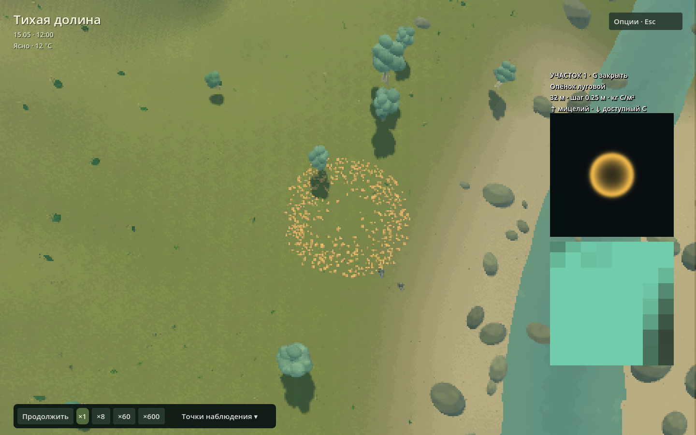

G показывает **ближайший к камере по горизонтали центр участка**: сверху B, снизу R, 32 м целиком. Название вида указано в подписи; выбор обновляется при движении камеры, в том числе на паузе. В почвенных слоях V те же локальные запасы показаны с шагом 0,25 м поверх основной сетки 4 м, без усреднения внутри участка; водные слои не измельчаются. Число и размер нарисованных шляпок отражают распределённую биомассу. Масса учитывается в полях модели.

В референсе диффундируют B и R; в связанном лесу пространственно распространяется B, а ресурс читается у общей почвы, без независимой диффузии зеркала R. Пятиточечная диффузия имеет отражающие границы, шаг ограничен `dt ≤ 0,225 dx² / max(D)` и скоростью реакции. Все переносы ограничены запасом. Гифы, корневая сеть, споры и вертикальное строение почвы в этой схеме отсутствуют. Контроли сравнивают однородную правую часть с независимым расчётом, случаи без инокулюма/ресурса/диффузии, углеродный баланс, плодовые переносы, чувствительность к сетке/шагу и точное продолжение снимка.

## 9. Животные, память и популяции

[animals.gd](../scripts/animals.gd), [animal_definition.gd](../scripts/animal_definition.gd), [data/animals](../data/animals), [геометрия и движение](animal-motion.md).

| Вид | Начальная численность | Основные роли сценария |
|---|---:|---|
| Заяц | 24 | Растительный корм, добыча хищника |
| Лиса | 2 | Поиск добычи, охота, падаль |
| Рыжая полёвка | 48 | Мелкий растительный корм/семена, добыча |
| Дрозд | 12 | Полёт, растительный корм и беспозвоночные, перенос семян |
| Кабан | 4 | Всеядность, рытьё и вытаптывание |

Таблица задаёт начальные численности. Животные имеют конечные C/N/P, возраст, пол, энергообеспечение, состояния поведения и индивидуальные признаки. Поиск локальный, с пространственным индексом; ограниченная память хранит до четырёх кормовых мест. Домашняя область, сон и экскурсии привязаны к состоянию и солнечному времени. Поведение задаётся правилами агентной модели.

Поедание снимает действительные запасы растений, плодовых тел, насекомых или падали. Метаболизм учитывает выходы; смерть переводит тело в конечную падаль. Потомство оплачивается родительским резервом, есть родительские ID и наследование признаков. Численность меняется через рождение и смерть; долгосрочная устойчивость популяций остаётся открытым вопросом.

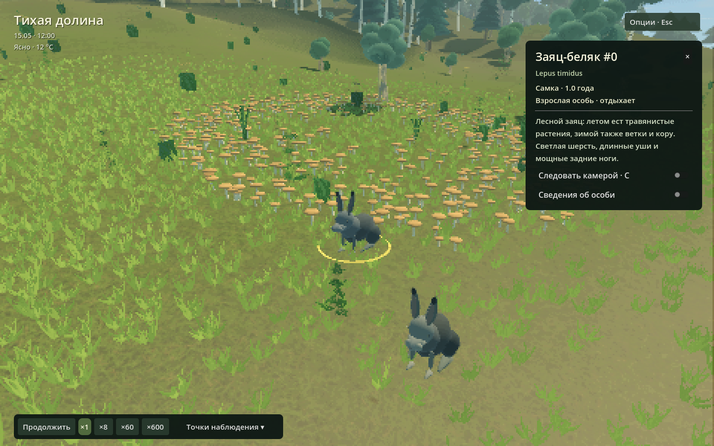

Перемещение подшаговое, учитывает глубину воды, склон и способности ресурса вида; дрозд может летать. Выбор объекта и слежение используют **показанную** позицию из завершённого кадра. Анимация лап/крыльев не оплачивает корм и не двигает модель самостоятельно.

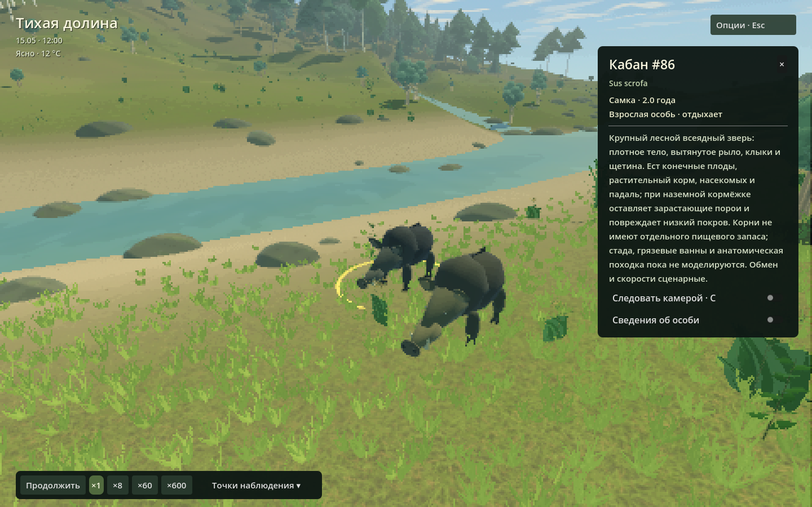

## 10. Среда обитания, насекомые и следы

[habitat.gd](../scripts/habitat.gd), [habitat_view.gd](../scripts/habitat_view.gd).

Грубая сетка содержит конечные C/N/P пулы агрегированных беспозвоночных: опылители, древесные и детритные группы. Нарисованные жуки представляют агрегированные группы. Нектар оплачивается растением, доступность опылителей влияет на размножение. Падаль оплачивается погибшим телом. Переносимые семена резервируются из конечного материнского запаса до высадки.

Трафик животных создаёт следы и воздействует на растения (вытаптывание/рытьё); видимые тропинки — представление накопленного трафика. Высота расчётного дна при этом сохраняется. Эрозия и механическое уплотнение грунта отсутствуют; беспозвоночные представлены агрегированными трофическими группами.

## 11. Наблюдение и сохранения

[observation.gd](../scripts/observation.gd), [world_state.gd](../scripts/world_state.gd), композиция [forest.gd](../scripts/forest.gd).

Общий наблюдатель выбирает растения, грибы и животных по показанной геометрии. Карточка показывает состояние выбранного объекта. Карта V переводит SI в удобные единицы на копии массива.

Сохранение содержит модели, накопленные потоки, незавершённый временной остаток, камеру/выбор и параметры сцены. Запись идёт через временный файл и переименование. Загрузка проверяет версии, совместимость конфигурации/рельефа/источников, согласованность часов и межмодельных ссылок; при поздней ошибке восстанавливает прежние состояния. Повреждённое или старое несовместимое сохранение нельзя «принять наполовину». Нативный водный checkpoint v3 поддерживает веса источников. Целое сохранение мира v1 дополнительно включает остальные модели и состояние наблюдателя. Рельеф текущего нового мира имеет `landscape_revision=3`; прежние несовместимые ландшафты отклоняются до изменения моделей, пользовательские файлы сохраняются.

Численные запасы нативных ядер — float64; векторы движка и часть визуальных данных — float32. Точное продолжение проверяется на указанном в документации стеке; межплатформенная битовая идентичность ещё требует проверки.

## 12. Что является только изображением

[atmosphere.gd](../scripts/atmosphere.gd), [cloud_deck.gd](../scripts/cloud_deck.gd), [water_view.gd](../scripts/water_view.gd), [painterly_style.gd](../scripts/painterly_style.gd), [shaders](../shaders).

Мир рисуется Terrain3D и пакетной геометрией/уровнями детализации. Основной пиксельный viewport при окне 1440×900 имеет 480×300 пикселей; интерфейс остаётся полноразмерным. Формы крон, трава, окраска почвы, шляпки, дождевые частицы и волны отображают данные моделей.

Нижний облачный слой имеет общее поле плотности для неба, облачной тени и пространственных осадков. Общий HDR-растр 1024×1024 сглаживает проекцию слоя; верхние тонкие облака используют отдельный процедурный шум. Мягкость даёт конечный солнечный диск и растровая фильтрация. Объёмный свет — грубый эффект Forward+ (размер 64, 32 слоя глубины), по умолчанию включён. Водный шейдер отображает глубину, отражения, волны и дождевые круги. Местный ветер из общего поля задаёт направление и амплитуду нормалей ряби, а накопленное смещение переносит рисунок без скачка при повороте ветра. Спектральный расчёт волн и атмосферный радиационный перенос отсутствуют.

Низинный туман использует один native FogVolume над миром. Его плотность убывает за несколько метров над местной землёй, ослабляется на высоких склонах, в сухом/тёплом воздухе, при сильном ветре и дневном прогреве. Поле RH/T/скорости ветра берётся из отображаемой сетки фронта 16 × 16. Пятна медленно дрейфуют с погодным переносом. Объёмное рассеяние получает солнце, тени и ambient-подсветку Forward+; отдельный водный запас туману не назначается, конденсация отсутствует. Переключатель объёмных эффектов и почвенная диагностика управляют также этим слоем. [Проверки оврага и эффектов](../verification/2026-11-05-ravine-weather-life.md).

Графические переключатели и скрытые контрольные стили не меняют общий водный/CNP баланс. На карте V декоративный покров/туман могут отключаться для читаемости с восстановлением пользовательского выбора. Экспериментальный `modules/fluid` не подключён к текущему водному расчёту.

## Источники

- Bates et al. (2010), локально-инерциальная формулировка: [10.1016/j.jhydrol.2010.03.027](https://doi.org/10.1016/j.jhydrol.2010.03.027).
- de Almeida et al. (2012), стабилизация расхода: [10.1029/2011WR011570](https://doi.org/10.1029/2011WR011570).
- [Landlab OverlandFlow](https://github.com/landlab/landlab/tree/master/src/landlab/components/overland_flow), [GroundwaterDupuitPercolator](https://github.com/landlab/landlab/tree/master/src/landlab/components/groundwater): открытые реализации, изученные при разработке численного ядра.
- Karst, Dralle & Thompson (2016), биомасса–ресурс: [10.1371/journal.pone.0149254](https://doi.org/10.1371/journal.pone.0149254).
- Растительная аллометрия, фенология, почвенный CNP, трофика и поведения животных — собственные сценарные приближения. Их проверка по полевым данным ещё предстоит.

Датированные измерения и отрицательные контроли лежат в [verification](../verification/); воспроизводимые программы — в [tools](../tools/) и [native/checks.cpp](../native/checks.cpp). Каждый отчёт относится к указанной в нём ревизии.
